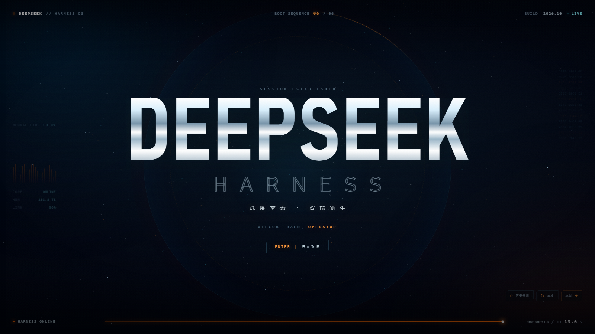

# dsh-startup-cinematic

**DeepSeek Harness 的电影感启动动画插件。** 深空星门 → 粒子鲸鱼 → 铬字揭幕 → 系统自检 → `SESSION ESTABLISHED`。约 13.6 秒，零外部请求，桌面端 / web profile 通用。

仓库：<https://github.com/mnanyu/dsh-startup-cinematic>  
在线预览：<https://mnanyu.github.io/dsh-startup-cinematic/>  
Release：<https://github.com/mnanyu/dsh-startup-cinematic/releases/tag/v1.0.0>



## 它是什么

| | |
|---|---|
| 六幕 | VOID / IGNITION / ASCENT / SIGIL / SYSTEMS / HARNESS |
| 视觉 | Canvas 星门、3600 个目标点聚合成鲸鱼、铬金属字、HUD、扫描线、故障闪切 |
| 转场 | 品牌 → 终端 → 终幕之间有短黑场切幕，避免交叉淡入重叠 |
| 音效 | WebAudio 现场合成的低频冲击、riser、故障切片与终幕和弦，无音频文件 |
| 交互 | 点击开启音效、`R` 重播、`Esc` 跳过、`M` 静音、终幕 `Enter` 进入 |
| 适配 | 桌面 / 手机竖屏；粒子量自动下调 |
| 依赖 | 运行时零依赖；构建需要 Node ≥ 20 |

更多画面：[开场](preview-intro.png) · [核心](preview-core.png) · [鲸鱼徽记](preview-brand.png) · [系统自检](preview-terminal.png)

## 安装

### 先卸载旧启动动画

如果你装过 `dsh-startup-screen`，请先移除，否则两个启动画面会叠加：

```bash
dsh plugin --profile desktop remove dsh-startup-screen
```

### 安装本插件

**方式 A：release tgz（推荐）**

从本仓库的 Releases 下载 `dsh-startup-cinematic-1.0.0.tgz`，然后完全退出 DeepSeek Harness Desktop，再执行：

```bash
dsh plugin --profile desktop add ./dsh-startup-cinematic-1.0.0.tgz
```

**方式 B：双击安装脚本**

下载 release 里的 `dsh-startup-cinematic-1.0.0-windows.zip`，解压后双击 `install.cmd`。脚本会优先安装同目录下的 `.tgz`，找不到时以 `link:` 方式安装源码目录。

**方式 C：源码 link（开发用）**

```bash
git clone https://github.com/mnanyu/dsh-startup-cinematic.git
cd dsh-startup-cinematic
npm run build
dsh plugin --profile desktop add link:.
```

安装完重新打开桌面端。设置页会多出 **「启动动画」**。

> DSH Desktop 的 profile 在运行时会锁 `package.json`，安装前必须**完全退出**桌面端，而不只是关窗口。web profile 同理，需要重启 `dsh web`。

## 设置

设置 →「启动动画」：

| 选项 | 默认 | 说明 |
|---|---|---|
| 启用 | 开 | 总开关 |
| 播放时机 | 每个浏览器会话一次 | `每个会话` / `每天` / `每次启动` |
| 速度倍率 | 1× | 0.5 – 2× |
| 身份名称 | `OPERATOR` | 终幕 `WELCOME BACK, NAME`，可填中文 |
| 播完自动进入 | 开 | 终幕约 1.2 秒后自动交给 DSH；关闭则等 ENTER / 点击 |
| 允许跳过 | 开 | 右下角 SKIP + `Esc` |
| 启动音效 | 开 | 浏览器要求先有一次点击才准出声；不点也完整播放画面 |

配置落在：

```text
%USERPROFILE%\.dsh\dsh-startup-cinematic.json
```

点 **立即预览** 会用当前编辑中的配置播放一次，不写入「本会话已播 / 今天已播」标记。

## 播放流程

| # | 时间 | 画面 |
|---|---|---|
| 01 | 0.0s | 深空黑幕、终端自检、单点脉冲 |
| 02 | 1.55s | 神经核心点亮、星门加速、HUD 上膛 |
| 03 | 3.55s | 矢量窗口、震屏、过曝冲击 |
| 04 | 4.06s | 鲸鱼粒子聚合、`DEEPSEEK` 铬字揭幕、故障闪切 |
| 05 | 7.28s | 系统自检终端、六行启动日志、进度条 |
| 06 | 10.62s | 最终锁定、`SESSION ESTABLISHED`、ENTER |

完整 13.6 秒；开启自动进入时约 13.75 秒交回 DSH。

## 实现方式

```
Host (lib/index.js)
  ├─ 往 index.html 的 <body> 前注入 #dsh-cinematic-root + iframe
  ├─ /dsh-cinematic/boot.html  自包含的动画文档
  └─ /dsh-cinematic/config    读取 / 保存设置

Browser (lib/client.js)
  ├─ 设置页「启动动画」
  ├─ Host 注入没生效时自举同一个 iframe
  └─ 立即预览
```

- **为什么用 iframe**：动画有自己的 `body`、字体、Canvas 和 CSS；iframe 把它隔离，绝不会污染 DSH 主界面。父层只负责一块黑底和消息握手。
- **失败保护**：iframe 8 秒内没有发 `ready`，父层自动移除黑幕；动画挂掉也不会把用户锁在黑屏里。
- **播放标记**：iframe 发 `ready` 后才写入会话 / 每日标记。加载失败的下次启动还会再试。
- **构建**：`scripts/build.mjs` 把 `index.html`、`boot.css`、`boot.js`、`whale-path.js` 内联成 `lib/boot.html`。仓库提交生成产物，源码安装不需要额外构建。

## 本地预览（不需要安装插件）

```bash
npm run build
# 直接双击仓库根目录的 index.html
```

根目录 `index.html` 是同一套动画的独立预览，支持：

```text
?name=秋枫              终幕欢迎名
?seek=6.2&freeze=1      定格某一秒
?speed=1.5              倍速
?mute=1                 静音
?exit=1                 终幕自动落地
```

## 在线预览

<https://mnanyu.github.io/dsh-startup-cinematic/>

仓库根目录就是静态预览页，由 GitHub Pages 从 `main` 分支根目录构建（`.nojekyll` 已加），无需额外构建。

## 开发

```bash
npm run build      # 生成 lib/boot.html
npm test           # 构建 + 内联/语法/握手冒烟检查
npm pack           # 生成 dsh-startup-cinematic-1.0.0.tgz
```

改动画只需要改根目录的 `index.html`、`boot.css`、`boot.js`、`whale-path.js`，然后 `npm run build`。**不要直接编辑 `lib/boot.html`**。

## 兼容性

- DeepSeek Harness Desktop / `dsh web`
- Node ≥ 20（仅构建与 Host 运行）
- Chromium 内核（Canvas 2D / WebAudio / CSS `clip-path` / `backdrop-filter`）
- 已做 `prefers-reduced-motion` 降级

## 排查

| 现象 | 检查 |
|---|---|
| 完全没动画 | 设置页有没有「启动动画」；装完是否完全退出并重启 |
| 黑屏几秒后进入 | iframe 路由没有加载成功；看 console 里 `/dsh-cinematic/boot.html` 是否 404 |
| 两个启动画面 | 还装着 `dsh-startup-screen`，先卸载 |
| 没声音 | 浏览器要求先点击；点画面或右下角声音按钮 |
| 设置保存失败 | 检查 `~/.dsh/dsh-startup-cinematic.json` 是否可写 |

## 素材说明

鲸鱼 SVG path 取自 DeepSeek Harness 自带 favicon，仅用于标识展示。动画中的音频全部由 WebAudio 实时合成，不含第三方录音。

## License

MIT。见 [LICENSE](LICENSE)。
